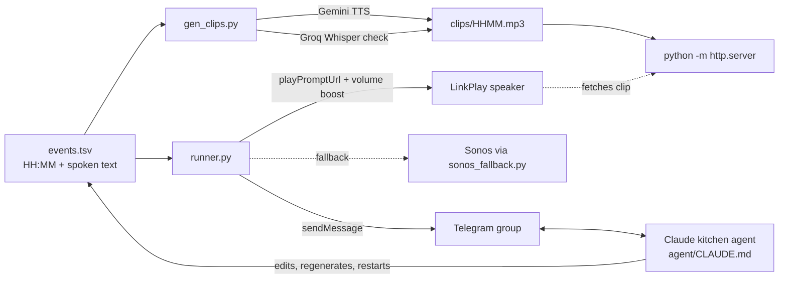

# Thanksgiving kitchen crew

A one-night hobby project from Thanksgiving 2026 (16 guests, dinner at 7:30): a
talking kitchen timer that announced every cooking step on the house speakers, and
a Claude agent in the cooks' Telegram group that answered recipe questions and
rescheduled announcements when plans changed.

It's shared as-is. It ran for one evening on one network; expect to adapt it.

The printed timeline, recipes and a few sample announcements are in [`docs/`](docs/)
(a GitHub Pages site).

## How it worked on the night

- The whole afternoon was planned as a timeline: nearly 60 steps from 12:35 to dinner,
  across two ovens, a charcoal grill (a Keg, kamado-style), a toaster oven and the counter.
- Each step became a line in `events.tsv`, written to be spoken aloud: a fun intro, the
  time, then the instruction with oven numbers and temperatures.
- `gen_clips.py` turned every line into an MP3 with Gemini text-to-speech, in a slow,
  laid-back West Coast voice, and checked each clip with a Whisper transcript.
- `runner.py` played each clip at its time on a LinkPlay (Up2Stream) streamer driving the
  house speakers, turning the volume up for the announcement and back down after.
  If that speaker didn't answer, it played the clip on a Sonos instead. It also posted the
  text to the Telegram group, so anyone who missed it could read it.
- A Claude agent sat in the Telegram group. "The mushrooms are here", "push the turkey
  check 20 minutes", "add an announcement at 6:10": it edited `events.tsv`, generated the
  new clips, restarted the runner and confirmed the change in one line.
- The same schedule was printed for the counter.

## Architecture



The speaker pulls each clip over HTTP from the machine running the announcer, so that
machine runs a tiny static file server in `announcer/`.

## Layout

```
announcer/
  runner.py             plays the schedule, posts to Telegram
  gen_clips.py          TTS + transcript check for a TSV of lines
  sonos_fallback.py     plays one clip on a Sonos (uv inline dependencies)
  events.example.tsv    the real schedule from the night
agent/CLAUDE.md         the kitchen assistant's instructions (template)
docs/                   GitHub Pages: landing page, timeline, recipes, sample clips
.env.example            every setting, with placeholder values
```

## Setup

You need Python 3.10+, `ffmpeg`/`ffprobe` and `curl` on PATH, and
[uv](https://docs.astral.sh/uv/) if you want the Sonos fallback.

1. **Settings.** `cp .env.example .env`, fill it in, and load it in every shell you use:
   `set -a; . ./.env; set +a`.
2. **Speaker.** Any LinkPlay-based streamer (Up2Stream, Arylic, many "WiFi audio" boards)
   accepts `http://<ip>/httpapi.asp?command=...`. Set `SPEAKER_HOST` to its mDNS name and
   `SPEAKER_IP` to its address as a fallback. A Sonos fallback is optional (`SONOS_IP`).
3. **TTS keys.** A Gemini API key (`GEMINI_API_KEY`) for speech and a Groq key
   (`GROQ_API_KEY`) for the Whisper check. Both have free tiers.
4. **Schedule and clips.**
   ```bash
   cd announcer
   cp events.example.tsv events.tsv        # then edit it
   python3 -u gen_clips.py events.tsv      # writes clips/HHMM.mp3
   ```
5. **Serve and run** (keep the machine awake, e.g. `caffeinate -dims` on macOS):
   ```bash
   python3 -m http.server 8765 > http.log 2>&1 &
   nohup python3 -u runner.py > runner.log 2>&1 & echo $! > runner.pid
   python3 runner.py --play 1900           # test one clip now
   ```
6. **Telegram bot (optional).** Make a bot with @BotFather, add it to a group, and set
   `TELEGRAM_BOT_TOKEN` and `TELEGRAM_CHAT_ID` so the runner posts each announcement.
   For the bot to see every group message (not just commands), turn off its privacy
   mode in BotFather or make it a group admin.
7. **The agent (optional).** Fill in `agent/CLAUDE.md` and run it as a long-lived agent
   connected to the same bot. On the night this ran in [Paseo](https://github.com/getpaseo/paseo)
   behind a Telegram bridge; the general version of that setup, with group chat support,
   is [agent-desk-kit](https://github.com/michael-ford/agent-desk-kit) (see its
   `bridge/` and `agents/` READMEs). The agent needs shell access to this folder and
   the `.env` values.

## events.tsv format

One announcement per line, `HH:MM<TAB>spoken text`, 24-hour time, sorted:

```
17:12	Ayy, cheese time, baby. It's five twelve. Brie into the toaster oven downstairs at three seventy-five, fifteen minutes.
17:25	Heads up, friends! The potatoes go in in five minutes!
```

- The clip for `17:12` is `clips/1712.mp3`. One event per minute.
- Write times and temperatures the way they should be said ("three seventy-five").
- Times are for today: the runner combines them with the current date at startup.
- `MUTE="1900 1905"` posts those events to Telegram without playing audio.

## Lessons learned

- **TTS style tags leak.** Gemini TTS takes a style prompt in brackets before the text,
  and sometimes reads it out loud: "Slow, smooth, laid-back West Coast hip-hop drawl...".
  Listening to 60 clips isn't practical, so `gen_clips.py` transcribes every clip with
  Whisper. If any style word shows up, it trims the clip to start just before the first
  real word; if the leak is still there it regenerates, up to four times. A line that
  fails four times needs rewording.
- **Restarting replays the last event.** The runner reads `events.tsv` only at startup,
  so every schedule change means a restart, and on start it plays anything less than two
  minutes old (so a restart during an event doesn't lose it). Restarting just after an
  announcement plays it twice. The agent's instructions say to wait out that window.
- **Free TTS quota runs out.** About 60 lines plus a few rounds of edits used up the main
  model's free daily quota before dinner. The Flash Lite TTS model has its own daily
  quota, and switching `TTS_MODEL` kept the rest of the evening going.
- **Boost, then restore.** Announcements need to cut through a loud kitchen, but music
  was playing on the same speaker. The runner reads the current volume, starts the clip,
  raises the volume by `BOOST` once playback has begun, and restores it just before the
  clip ends, retrying the restore once if the speaker is slow to answer.
- **Resolve the speaker by name.** Its DHCP address can change mid-evening; the runner
  looks up the mDNS name before each clip and falls back to the fixed IP.
- **Keep the voice, drop the catchphrases.** A "West Coast" persona was fun; specific
  celebrity catchphrases got vetoed. The style lives in the text ("nephew", "cuz",
  "y'all") as much as in the voice.
- **Short replies.** Cooks read the group on a phone with wet hands. One-line answers and
  one-line confirmations of every change worked best.

## Licence

MIT, see [`LICENSE`](LICENSE).
