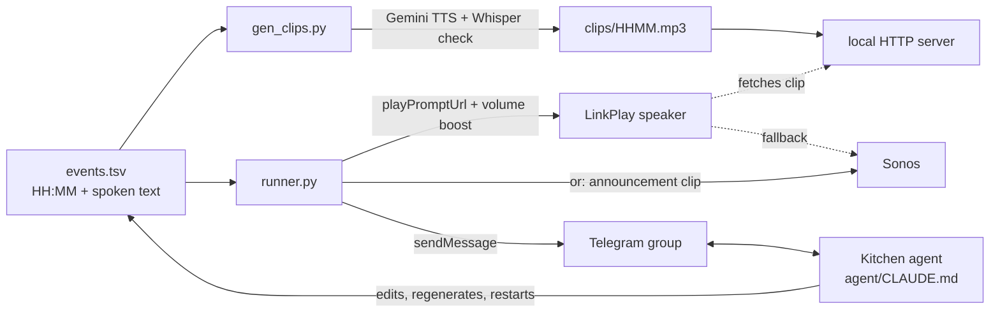

# Thanksgiving Kitchen Agent

Run a big holiday dinner off a talking schedule. Every cooking step is announced on
your house speaker at its time ("It's three o'clock, and the bird is going on!"), the
same text lands in the cooks' Telegram group, and an AI agent in that group answers
recipe questions and reschedules announcements when plans change.

This repo is the method plus the small amount of code it needs. The timeline and
recipes in [`docs/`](docs/) are examples; plan your own dinner and feed it in.



## How it works

### 1. The kitchen agent

- **Where it lives.** A Telegram bot added to a group with everyone who's cooking. The
  bot is connected to a long-lived Claude agent with shell access to this repo. A
  ready-made way to run one is [agent-desk-kit](https://github.com/michael-ford/agent-desk-kit)
  (Paseo + a Telegram bridge with group chat support; see its `bridge/` and `agents/`
  READMEs). Turn off the bot's privacy mode in BotFather (or make it an admin) so it sees
  every group message.
- **Its instructions** are [`agent/CLAUDE.md`](agent/CLAUDE.md), a template: fill in the
  dinner time, your dietary constraints, which oven is which, and the announcement style.
- **How cooks talk to it.** Plain chat: "how long does the stuffing bake?", "is the
  turkey done at 150?". It answers from the timeline and recipes in one or two lines.
  Short replies matter: people read on a phone with wet hands.
- **Changing the schedule by chat.** "Mushrooms are here", "push the turkey check 20
  minutes", "add an announcement at 6:10 to start the gravy". The agent writes the new
  lines, generates their clips, merges them into `events.tsv`, restarts the runner, and
  confirms the change in one line. To move an event it deletes the old time's line and
  clip and adds the new one.

### 2. The voice

**Writing the lines.** Each line in `events.tsv` is written to be heard across a loud
kitchen:

1. A short, varied fun intro ("Ayy, cheese time, baby.", "Heads up, friends!").
2. The time, spoken ("It's five twelve.").
3. One clear instruction with the station and temperature ("Brie into the toaster oven
   at three seventy-five, fifteen minutes.").

Write numbers the way they should be said. Add a "heads up, five minutes" line before
the big moves. Give the persona a flavour (ours was a laid-back West Coast voice:
"nephew", "cuz", "y'all"), but skip celebrity catchphrases.

**Text-to-speech** (`announcer/gen_clips.py`):

- **Gemini TTS** with a bracketed style tag in front of the text and a prebuilt voice
  name: `[slow, smooth, laid-back West Coast hip-hop drawl, relaxed and cool, grinning]
  It's five twelve...`, voice `Algenib`. Both are settings (`TTS_STYLE`, `TTS_VOICE`).
- **Tag leakage.** The model sometimes reads the style tag out loud. Nobody can listen
  to 60 clips, so every clip is transcribed with Whisper (Groq). If any style word shows
  up (`LEAK_WORDS`), the clip is trimmed to start just before the first real word, using
  Whisper's word timestamps. It's checked again; if the tag is still audible the line is
  regenerated, up to four times. A line that prints `BAD` four times needs rewording.
- **Audio clean-up** with ffmpeg: trim trailing silence, pad 0.6 s at the end,
  loudness-normalise hot (−11 LUFS) so it cuts through kitchen noise, and add 300 ms of
  silence at the start because some speakers clip the first syllable.
- **Quota.** About 60 lines plus a few rounds of edits can use up a free daily TTS
  quota. The Flash Lite TTS model has its own quota; set `TTS_MODEL` to it and carry on.
  The generator also backs off and retries on rate-limit errors.

### 3. The speaker

- **LinkPlay / Up2Stream HTTP API.** Many WiFi audio streamers (Up2Stream, Arylic and
  other LinkPlay boards) accept `http://<speaker>/httpapi.asp?command=...`:
  - `getPlayerStatus` returns JSON including the current `vol`.
  - `playPromptUrl:<url>` plays a short clip on top of the current source.
  - `setPlayerCmd:vol:<n>` sets the volume.
- **Temporary volume boost.** Read the volume, start the clip, wait 0.7 s, raise the
  volume by `BOOST`, sleep for the clip's length (from `ffprobe`), and restore the old
  volume just before the clip ends, retrying once if the speaker is slow. The music
  underneath never blasts.
- **Serving clips.** The speaker fetches the MP3 itself, so run
  `python3 -m http.server 8765` in `announcer/` and set `CLIP_BASE_URL` to this machine's
  LAN address.
- **Finding the speaker.** DHCP addresses can change mid-evening, so the runner looks
  up the speaker's mDNS name (`SPEAKER_HOST`) before each clip and falls back to a fixed
  IP (`SPEAKER_IP`).
- **Sonos.** Set `SPEAKER_TYPE=sonos` (with `SONOS_IP`, `SONOS_VOLUME`) to use a Sonos
  as the only speaker. `sonos_play.py` sends each clip as a Sonos announcement: Sonos
  lowers whatever is playing, plays the clip at `SONOS_VOLUME`, then resumes the music,
  so no volume boost or restore is needed. With `SPEAKER_TYPE=linkplay`, a `SONOS_IP` is
  used as the fallback when the LinkPlay speaker fails twice.

### 4. The runner

`announcer/runner.py`:

- Reads `events.tsv` **once, at startup**, so every schedule change needs a restart.
- On start it plays any event less than 2 minutes old (`REPLAY_WINDOW_MIN`), so a
  restart during an event doesn't lose it. The catch: restarting just after an
  announcement plays it twice. Wait out the window.
- Waits for each event's time, plays the clip, then posts the text to the Telegram group
  (`TELEGRAM_BOT_TOKEN`, `TELEGRAM_CHAT_ID`) so anyone who missed it can read it.
- `MUTE="1900 1905"` posts those events as text only (handy once dinner conversation
  starts).
- `python3 runner.py --play 1712` plays one clip now, for testing.

### 5. Planning your own dinner

1. **Start from dinner time and work backwards.** List every dish with its cook time,
   rest time and temperature. Put "everything to the table" 5 minutes before you eat.
2. **Map the stations.** Every oven, the grill, the stovetop, the toaster oven. Give them
   names everyone agrees on ("oven 1", "oven 2 = upstairs") and check that no station
   needs two temperatures at once. That's where the plan usually breaks.
3. **Add the prep.** Chopping, glazes, dressings and bringing things to room
   temperature go into the quiet hours early on.
4. **Add the checks.** Thermometer checks, stirs, pan swaps, and a 5-minute heads-up
   before each big move.
5. **Turn it into `events.tsv`**, one spoken line per step, and print the same timeline
   for the counter. See the [example timeline](docs/timeline.html) and
   [`announcer/events.example.tsv`](announcer/events.example.tsv).

## Quick start

Needs Python 3.10+, `ffmpeg`/`ffprobe` and `curl` on PATH, and
[uv](https://docs.astral.sh/uv/) for Sonos playback.

```bash
cp .env.example .env                       # fill in keys, speaker, Telegram
set -a; . ./.env; set +a
cd announcer
cp events.example.tsv events.tsv           # replace with your own schedule
python3 -u gen_clips.py events.tsv         # writes clips/HHMM.mp3, prints clean/BAD
python3 -m http.server 8765 > http.log 2>&1 &
python3 runner.py --play 1900              # test one clip
nohup python3 -u runner.py > runner.log 2>&1 & echo $! > runner.pid
```

Keep the machine awake (`caffeinate -dims` on macOS). Then fill in
`agent/CLAUDE.md` and start the agent in your Telegram group.

### events.tsv format

One announcement per line, `HH:MM<TAB>spoken text`, 24-hour, sorted, one event per
minute. The clip for `17:12` is `clips/1712.mp3`. Times are for today.

```
17:12	Ayy, cheese time, baby. It's five twelve. Brie into the toaster oven at three seventy-five, fifteen minutes.
17:25	Heads up, friends! The potatoes go in in five minutes!
```

## Layout

```
announcer/
  runner.py             plays the schedule, posts to Telegram
  gen_clips.py          TTS + transcript check for a TSV of lines
  sonos_play.py         plays one clip on a Sonos (uv inline dependencies)
  events.example.tsv    an example schedule for a 7:30 PM dinner
agent/CLAUDE.md         the kitchen agent's instructions (template)
docs/                   GitHub Pages: overview, example timeline and recipes, sample clips
.env.example            every setting, with placeholder values
```

## Licence

MIT, see [`LICENSE`](LICENSE).
